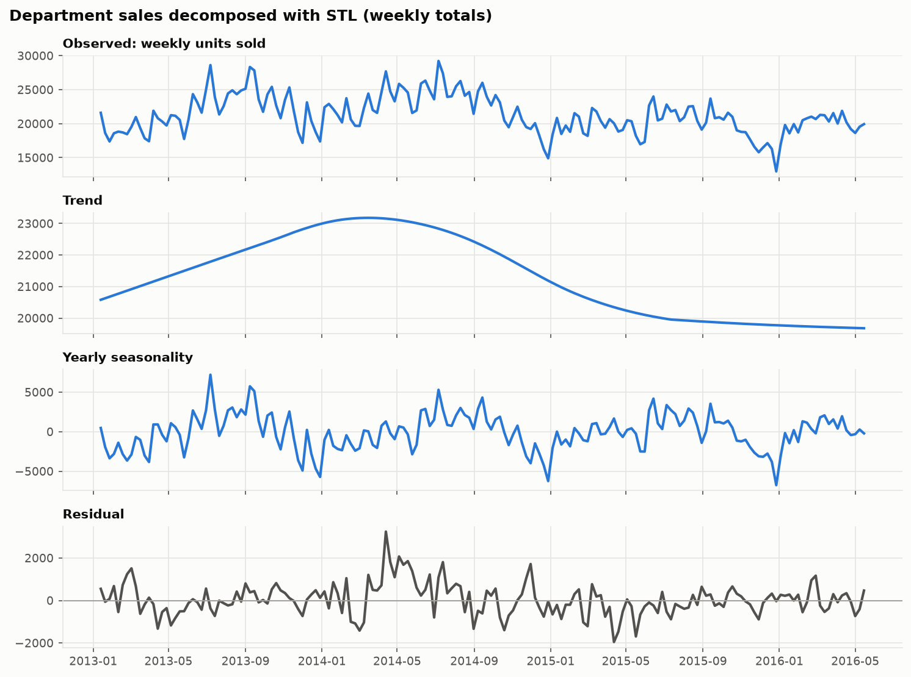
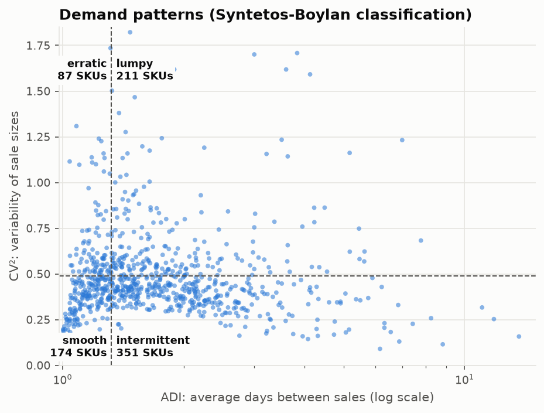
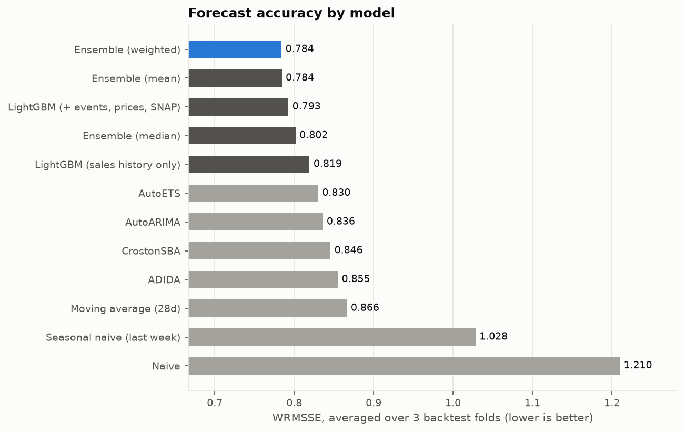
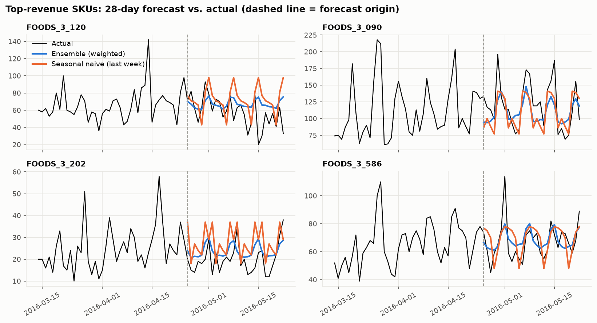
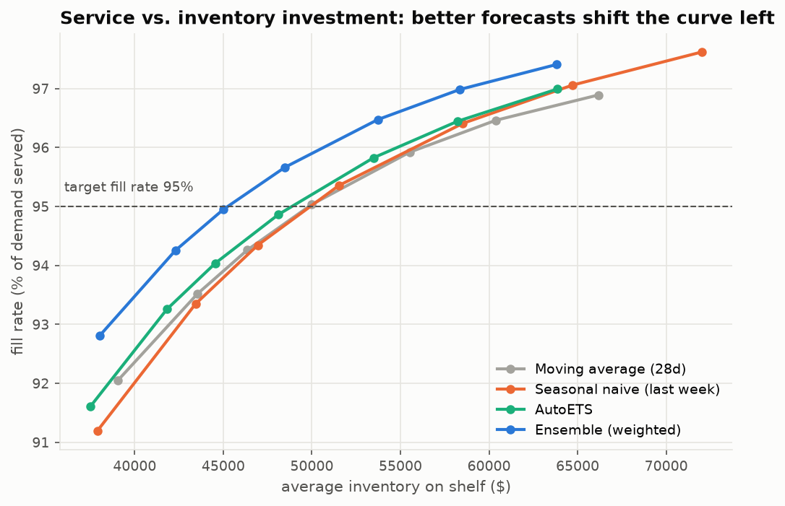

# Retail Demand Forecasting & Inventory Optimization


**SKU-level daily demand forecasting for 823 Walmart food products (M5 dataset). The forecast is then turned into an inventory policy and measured in dollars.**

> **Headline results**
> - A statistical + machine-learning **ensemble cuts forecast error by 24%** vs. a seasonal-naive benchmark (WRMSSE, 3 rolling backtest folds).
> - **Price, event and SNAP features add 3.3%** accuracy to LightGBM (ablation study).
> - In simulation, the forecast-driven reorder policy reaches a 95% fill rate with **9% less inventory** than a moving-average policy.

---

## 1. Business problem

Retailers lose money in two opposite ways. **Stockouts** lose sales and customers. **Overstock** ties up cash and food expires. Both are driven by the demand forecast. This project answers:

> *For each product in a store's food department, how many units will sell each day for the next 28 days, and how much stock should we hold to serve 95% of demand at minimum cost?*

The project follows **CRISP-DM**. Each phase maps to a module:

| Phase | Module | Output |
|---|---|---|
| Business & data understanding | `data.py`, `pipeline.py eda` | data-quality report, EDA figures |
| Data preparation | `data.py`, `features.py` | clean panel, leak-free features |
| Modeling | `models.py`, `ensemble.py` | 12 forecasting approaches |
| Evaluation | `backtest.py`, `evaluation.py` | rolling-origin metrics |
| Business evaluation | `inventory.py` | fill rate vs. inventory frontier |
| Deployment | `pipeline.py forecast` | next-28-day forecast + per-SKU inventory plan |

## 2. Data

[M5 Forecasting competition](https://www.kaggle.com/competitions/m5-forecasting-accuracy) (Walmart, 2011–2016), downloaded automatically from a public mirror, so no Kaggle account is needed.
Study slice (configurable in `configs/default.yaml`): **store CA_3, department FOODS_3: 823 SKUs, 2013-01-01 → 2016-05-22, 935k rows.**

Data preparation decisions (all logged to `reports/data_quality.json`):
- **Dropped 319,711 pre-launch rows**: zeros before a product reaches the shelf mean "not available", not "no demand".
- Flagged Christmas store closures. Filled price gaps. Validated with no duplicates, no gaps and no negatives.
- **37% of product-days have zero sales**: most SKUs are *intermittent* or *lumpy* (Syntetos-Boylan classification).

| | |
|---|---|
|  |  |

Weekends sell markedly more, and food sales rise **12%** on SNAP (food-assistance) payment days (`reports/figures/eda_weekly_snap.png`).

## 3. Approach

**Evaluation first.** Rolling-origin backtest with 3 folds × 28 days. Every model is retrained at each cutoff. The primary metric is **WRMSSE** (official M5 metric: scale-free, revenue-weighted). WAPE and bias are reported for business readers.

**Models.**
- **Benchmarks:** Naive, Seasonal naive, 28-day moving average.
- **Statistical (one per SKU, `statsforecast`):** AutoETS, AutoARIMA (SARIMA with weekly seasonality), Croston-SBA and ADIDA for intermittent demand.
- **Machine learning:** one *global* LightGBM across all SKUs. It uses a Tweedie loss for zero-inflated counts and the direct multi-horizon strategy: every sales feature is lagged ≥ 28 days, so all 28 days are predicted at once without leakage. Features: lags, rolling stats, weekday profile, calendar, events, SNAP, price and discount signals.
- **Ensembles:** mean, median, and inverse-error weighted. Weights are learned only on *earlier* folds.

**Leakage guards.** Time-ordered folds; features lagged ≥ horizon; prices use expanding statistics only; no early stopping on test data. `tests/test_features.py::test_no_future_leakage` overwrites future sales and asserts no feature changes.

## 4. Results

| Model | WRMSSE ↓ | WAPE ↓ | Bias | Skill vs. seasonal naive |
|---|---:|---:|---:|---:|
| **Ensemble (weighted)** | **0.784** | 54.6% | +3.1% | 23.7% |
| Ensemble (mean) | 0.784 | 54.6% | +3.1% | 23.7% |
| LightGBM (+ events, prices, SNAP) | 0.793 | 54.9% | +3.3% | 22.9% |
| Ensemble (median) | 0.802 | 55.6% | +3.5% | 22.0% |
| LightGBM (sales history only) | 0.819 | 58.4% | +1.5% | 20.3% |
| AutoETS | 0.830 | 57.2% | +3.3% | 19.3% |
| AutoARIMA | 0.836 | 57.4% | +2.8% | 18.7% |
| CrostonSBA | 0.846 | 59.4% | +0.7% | 17.8% |
| ADIDA | 0.855 | 58.3% | +5.5% | 16.9% |
| Moving average (28d) | 0.866 | 57.9% | +2.4% | 15.7% |
| Seasonal naive (last week) | 1.028 | 68.0% | +1.1% | 0.0% |
| Naive | 1.210 | 80.4% | +23.3% | -17.7% |



- **The ensemble wins.** It combines ETS, ARIMA and LightGBM, whose errors are imperfectly correlated. This is the M4/M5 lesson reproduced.
- **Global ML beats local statistics.** LightGBM learns across 823 products and uses external drivers.
- **Demand signal enrichment pays.** LightGBM with events, prices and SNAP beats the sales-history-only version by 3.3% WRMSSE.
- **Smoothing beats copying** for intermittent SKUs. The 28-day moving average beats seasonal naive.



## 5. From forecast to decision: inventory optimization

Periodic-review **(R, S) policy**: review every 7 days, 3-day lead time, lost sales.

- Order-up-to level = forecast over the review period plus lead time, plus **safety stock z·σ·√(R+L)**.
- **σ is each SKU's out-of-sample forecast error** from the backtest, so a better forecast means less safety stock.

The policy is simulated day-by-day on the final fold with real sales, for several service targets:



| Forecast driving the policy | Avg. inventory for 95% fill rate | vs. moving average |
|---|---:|---:|
| Ensemble (weighted) | $45,247 | -9.2% |
| AutoETS | $48,870 | -1.9% |
| Moving average (28d) | $49,830 | — |
| Seasonal naive (last week) | $49,912 | +0.2% |

The `forecast` stage retrains the winning model on all history and writes **`reports/inventory_plan.csv`**. For every SKU it gives the next-7/28-day forecast, safety stock, reorder point, order-up-to level and safety-stock value.

## 6. Run it

```bash
make setup     # uv venv + install (or: pip install -e ".[dev]")
make all       # download data -> EDA -> backtest -> inventory -> forecast  (~10 min on a laptop)
make test      # 11 unit tests on synthetic data, no download needed
```

Individual stages: `python -m demandcast.pipeline {prepare|eda|backtest|inventory|forecast}`.
To study another store or department, edit `configs/default.yaml`.

<details><summary>Project structure</summary>

```
configs/default.yaml          all settings (slice, horizon, folds, model + inventory params)
src/demandcast/
  data.py                     download, clean, validate, demand classification, future frame
  features.py                 leak-free lag / rolling / calendar / event / price features
  models.py                   benchmarks, statsforecast models, global LightGBM
  ensemble.py                 mean / median / leak-free weighted combination
  evaluation.py               WRMSSE, WAPE, bias
  backtest.py                 rolling-origin loop
  inventory.py                safety stock, reorder point, (R,S) simulation, inventory plan
  plots.py                    figures
  pipeline.py                 CLI
tests/                        leakage, metrics, inventory-math tests
docs/                         lecture notes (PDF) explaining every method used
```
</details>

## 7. Limitations & next steps

- Single store/department and a 28-day inventory simulation. No case packs, MOQs or shelf limits.
- σ√L assumes independent daily errors.
- Next: quantile (probabilistic) forecasts for direct stock setting, horizon-specific models with shorter lags, hierarchical reconciliation, weather data, and pretrained foundation models (Chronos, TimesFM, or orchestrated via [TimeCopilot](https://timecopilot.dev)) as ensemble members.

## 8. Learn the methods

[`docs/Demand_Forecasting_Lecture_Notes.pdf`](docs/Demand_Forecasting_Lecture_Notes.pdf) explains every technique used here in lecture-note form. It covers CRISP-DM, STL, intermittent demand, ETS, SARIMA, Croston, LightGBM, Tweedie loss, backtesting, WRMSSE, ensembles, safety stock and (R,S) policies, with exercises.

---
*Data: M5 Forecasting Competition (Makridakis et al., 2022). Built with pandas, statsforecast, LightGBM, statsmodels.*
